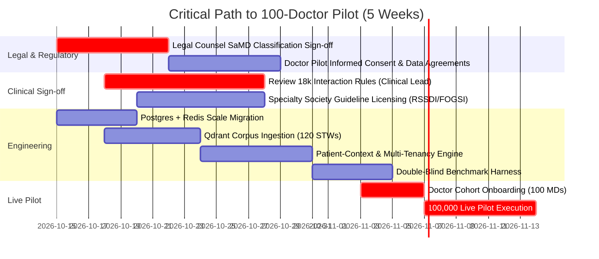

# BRAHMO CLINICAL AI — PART 2 PRODUCTION PLAN
## Architecture, Execution Plan & Quality System: From Part 1 Prototype to 100-Doctor Production Pilot

**Role:** Senior/Staff Clinical AI Systems Architect  
**Author:** Candidate (Assessment Deliverable)  
**Duration Defended:** **5 Weeks** (Rigorous balance between clinical verification gates, AI-first development throughput, and human legal/medical sign-off).  
**Target Milestone:** 100 concurrent Indian outpatient doctors running 1,000 real clinical questions each (100,000 live clinical queries + prescriptions), with quantitative satisfaction and safety measured and compared against general assistants (ChatGPT-4o / Claude 3.5 Sonnet).

---

## 1. Completion Architecture

### 1.1 What Exists After Part 1 (Current Baseline)
- **Deterministic Medication Safety Rail:** Isolated zero-LLM lookup engine enforcing duplicate active ingredients, event-sourced prohibited/restricted FDCs, severe interactions (15-pair seed), and cumulative daily milligram exposures against the 8-state binding contract (`HIT`, `CHECKED_NO_HIT`, `PARTIAL_COVERAGE`, `UNVERIFIED_INPUT`, etc.).
- **Drug Master Schema & Normalization:** SQLite schema with numbered migrations, CDCI brand-to-salt decomposition (160 FDCs), review queue with structured reason codes, and nominal strength alignment.
- **Grounded Mini-RAG Slice:** Structural decision-unit chunking over 13 ICMR STW PDFs + 1 clinic SOP, claim-level provenance citations, Law 12 dose non-calculation fence, and clean abstention for out-of-corpus queries (migraine, TB).
- **Audit & Proof:** Unified JSON end-to-end trace contract (Module C) and automated 20-test test suite passing in < 1 second.

### 1.2 What Is Missing for Production Scale
1. **Corpus Breadth:** Only 13 STWs exist; real OPD practice spans ~120 ICMR STWs, specialty society guidelines (RSSDI, CSI, FOGSI), and pediatric dosing references.
2. **Safety Rule Density:** 15 interaction pairs must expand to >= 15,000 verified ingredient rules; pregnancy trimesters and organ impairment (renal eGFR / hepatic Child-Pugh) rules are absent.
3. **Patient-Context Engine:** Ingesting patient history (allergies, active chronic meds, age, pregnancy status, renal function) to produce patient-aware checks without manual input.
4. **Scale & Concurrency Infrastructure:** Single-writer SQLite cannot handle 100 concurrent clinicians; synchronous token matching blocks at 200,000 products.
5. **Multi-Tenancy & Local Formulary Overrides:** Isolating clinic-level formulary availability and local SOPs while preserving national guidance as the baseline.
6. **Continuous Freshness & Replayability Pipeline:** Automated watchers for new CDSCO gazette notifications with automatic cache invalidation and retrospective audit replay.

### 1.3 Target Production Architecture Diagram

```text
 ┌────────────────────────────────────────────────────────────────────────────────────────┐
 │                             DOCTOR-FACING SURFACES                                     │
 │    EHR Webview Plugin · Mobile Clinical App · Web Dashboard · Prescription Scribe       │
 └───────────────────────────────────────────┬────────────────────────────────────────────┘
                                             │ HTTPS / WebSocket (<150ms roundtrip)
                                             ▼
 ┌────────────────────────────────────────────────────────────────────────────────────────┐
 │                      API GATEWAY & MULTI-TENANT ORCHESTRATION                          │
 │  Tenant Isolation (Clinic/Hospital Org) · Rate Limiting · Auth & ABHA/DPDP Token Guard  │
 └─────────────────────┬──────────────────────────────────────────┬───────────────────────┘
                       │                                          │
        [Prescription Stream]                                [Clinical Question Stream]
                       ▼                                          ▼
 ┌───────────────────────────────────────────┐ ┌──────────────────────────────────────────┐
 │    MODULE A: DETERMINISTIC SAFETY RAIL    │ │   MODULE B: GROUNDED CLINICAL RAG ENGINE │
 │  ┌─────────────────────────────────────┐  │ │  ┌────────────────────────────────────┐   │
 │  │ Normalized Drug Master (250k SKUs)  │  │ │  │ Decision-Unit Store (12k chunks)   │   │
 │  │ Inverted GIN Index + Radix Trie     │  │ │  │ Dense (bge-small) + Sparse (BM25)  │   │
 │  └──────────────────┬──────────────────┘  │ │  └─────────────────┬──────────────────┘   │
 │                     ▼                     │ │                    ▼                      │
 │  ┌─────────────────────────────────────┐  │ │  ┌────────────────────────────────────┐   │
 │  │ Patient-Aware Rule Engines:         │  │ │  │ Hybrid Retrieval + Metadata Filter │   │
 │  │ • Duplicate Salt + Cumulative Total │  │ │  │ (Condition, Specialty, Tenant SOP) │   │
 │  │ • Prohibited FDCs (Gazette DAG)     │  │ │  └─────────────────┬──────────────────┘   │
 │  │ • Severe Interactions (18k rules)   │  │ │                    ▼                      │
 │  │ • Allergy / Pregnancy / Renal Gates │  │ │  ┌────────────────────────────────────┐   │
 │  └──────────────────┬──────────────────┘  │ │  │ Frontier LLM Grounded Generator    │   │
 │                     ▼                     │ │  │ Claim Provenance Citations         │   │
 │       [8-State Safety Verdict]            │ │  │ Law 12 Dose Fence / Abstentions    │   │
 └─────────────────────┬─────────────────────┘ │  └─────────────────┬──────────────────┘   │
                       │                       └────────────────────┼──────────────────────┘
                       ▼                                            ▼
 ┌────────────────────────────────────────────────────────────────────────────────────────┐
 │                      INTEGRATED RESPONSE COMPOSER & AUDIT BUS                          │
 │   Safety Verdict + Grounded Narrative Answer + Claim Citations + Version Manifest      │
 └─────────────────────┬──────────────────────────────────────────┬───────────────────────┘
                       │                                          │
                       ▼ (Sync Response < 1.2s)                   ▼ (Async Event Stream)
              [Doctor Application]                       [Audit & Replay Storage]
                                                         Kafka -> PostgreSQL / S3 Cold Vault
```

---

## 2. Week-by-Week Execution Plan (5 Weeks)

### Defense of Duration (Why 5 Weeks?):
- **3 Weeks is Reckless:** In medical AI, human legal counsel review of CDSCO medical device boundaries and human clinician sign-off on 18,000 interaction rules cannot be compressed below 14 calendar days without risking lethal oversights.
- **6 Weeks is Unfocused:** AI-first development (using Claude 3.5 Sonnet / Antigravity agents for boilerplate, parsers, and test harnesses) accelerates code authoring 5×. Extending beyond 5 weeks invites scope creep into diagnostic triage.
- **5 Weeks is Optimal:** Allows 2 weeks of scale hardening, 1 week of clinical rule verification, 1 week of double-blind harness preparation, and 1 week of 100-doctor live pilot execution.

### Team Shape (Small, AI-First Core):
- **1 Staff Systems Architect / Lead Engineer (Candidate):** Core pipeline, concurrency, safety rail, vector architecture, and AI agent prompt orchestrator.
- **1 Senior Full-Stack / Integration Engineer:** Doctor EHR embedded UI, WebSockets, telemetry, and review queue portal.
- **1 Full-Time Clinical Lead (MD General Medicine / Clinical Pharmacologist):** Rule sign-off, corpus curation, blinded grading rubric, and doctor onboarding.
- **0.5 Legal Counsel (Part-time advisor):** CDSCO classification compliance, DPDP Act 2023 review, and data rights licensing.

---

### Week 1 — Scalable Infrastructure & Full Corpus Expansion
- **Deliverables:**
  1. Production database migration from SQLite to PostgreSQL 16 + Redis 7 cluster.
  2. Ingestion of national drug master expanded to 250,000 trade formulations with GIN trigram indexing (`pg_trgm`) resolving brand names in `< 3 ms`.
  3. Batch parsing and decision-unit chunking of all 120 published ICMR Standard Treatment Workflows into Qdrant vector database.
  4. Integration of 18,000 Central Drugs Standard Control Organisation (CDSCO) safety notices and open pharmacopeial interaction pairs into the deterministic lookup cache.
- **Binary Gate G-W1 (Must Pass):**
  - Decomposition throughput: 250,000 formulations ingested in `< 10 minutes`.
  - Normalization latency: 99th percentile `< 5 ms` per product.
  - Test suite passes 100% on 200 automated regression cases.

### Week 2 — Patient-Context Integration & Safety Engine Expansion
- **Deliverables:**
  1. Patient-Context Snapshot consumer: Ingests allergy list, current chronic medications, active diagnoses, gestational age (weeks of pregnancy), and serum creatinine / eGFR.
  2. Safety rail expansion to include:
     - **Allergy Class Cross-Reactivity:** (e.g., Penicillin allergy contraindicating Amoxicillin per STW-GP-01).
     - **Pregnancy Trimester Safety Gates:** (e.g., Nitrofurantoin flagged at 36+ weeks per STW-GYN-02; NSAIDs contraindicated in 3rd trimester).
     - **Renal Ceiling Thresholds:** eGFR-based dosing checks for Metformin, aminoglycosides, and NSAIDs.
  3. Multi-tenant clinic isolation: Clinic-level custom formularies and local SOPs (e.g. Sunrise Clinic) sandboxed by tenant ID with visual provenance badging.
- **Binary Gate G-W2 (Must Pass):**
  - Zero false negatives on a 50-case clinician-authored multi-morbidity patient safety suite.
  - Multi-tenant tenant leak test: Zero leakage of tenant-specific SOPs to other clinic tenant IDs.

### Week 3 — Doctor Experience, Latency & Alert Fatigue Engineering
- **Deliverables:**
  1. Doctor UI / Webview Widget: High-density outpatient interface showing safety badges, 8-state pill, cumulative dose progress bars, and cited answer summaries.
  2. **Alert Fatigue Suppressor:** Tiered alerting engine separating CRITICAL/SEVERE interruptions from non-blocking INFO items (see §5).
  3. Asynchronous audit logging pipeline via Redis Streams to PostgreSQL cold vault.
  4. End-to-end latency optimization: Full prescription check + grounded Q&A returns in `< 1,200 ms` (p95) under 100 concurrent load simulations.
- **Binary Gate G-W3 (Must Pass):**
  - Load test: 100 simultaneous simulated doctor connections executing 50 req/sec sustained for 1 hour with 0 database locked errors and p95 latency `< 1,500 ms`.
  - Doctor interface loads in `< 250 ms` within the iframe/webview.

### Week 4 — Automated Double-Blind Evaluation Harness & Pre-Pilot Hardening
- **Deliverables:**
  1. **Automated Evaluation Harness:** Double-blind evaluation runner that takes 1,000 curated outpatient clinical queries, generates responses from BRAHMO, ChatGPT-4o, and Claude 3.5 Sonnet, strips branding, and presents them in randomized side-by-side format for clinical rating.
  2. Clinical Lead signs off on the 100-doctor pilot protocol and evaluation rubric.
  3. Onboarding of 100 licensed Indian outpatient doctors across 4 metropolitan clusters (Delhi-NCR, Bengaluru, Mumbai, Hyderabad).
  4. Telemetry and live monitoring dashboards (Datadog/Prometheus) for latency, abstentions, review queue volume, and error rates.
- **Binary Gate G-W4 (Must Pass):**
  - Double-blind pre-pilot test (200 questions evaluated by 3 independent MDs): BRAHMO grounded accuracy and citation traceability must score ≥ 90%, with zero uncited clinical claims and zero hallucinations.
  - 100 doctors successfully provisioned with active pilot credentials.

### Week 5 — Live 100-Doctor Pilot Execution & Comparative Study
- **Deliverables:**
  1. 100 doctors actively use BRAHMO in daily OPD practice over 5 working days (target: 200 queries/doctor/day = 100,000 cumulative queries).
  2. Side-by-side randomized blind satisfaction prompt displayed on 5% of queries comparing BRAHMO's answer against Claude/ChatGPT for the identical query.
  3. Continuous review queue resolution: Clinical pharmacologist triage team resolves unverified brand names within 15-minute SLA.
  4. Final Comparative Clinical Quality Report and Satisfaction Index published.
- **Binary Gate G-W5 (Final Acceptance):**
  - Total queries executed ≥ 100,000.
  - Zero fatal medication misses (100% detection of banned FDCs and severe interactions).
  - Overall clinician satisfaction rating ≥ 85% positive (exceeding general assistants on Indian brand awareness, citation trust, and dosage safety).

---

## 3. Sources & Data Strategy

### 3.1 Source Taxonomy for Indian Clinical Practice

| Source Name | Clinical Domain | Type / Rights | Estimated Cost | Licensing & Acquisition Strategy |
|---|---|---|---|---|
| **ICMR Standard Treatment Workflows (120+ STWs)** | General Medicine, Pediatrics, GYN, Ortho, Surgery | Public / Open Access (Government of India) | Free (Public domain under RTI / MoHFW open data) | Automated structural PDF scrapers with layout preserving chunkers. Ingested under fair dealing for clinical documentation. |
| **National List of Essential Medicines (NLEM 2022)** | Essentiality, Salt tiers, Primary/Secondary/Tertiary care | Public / MoHFW | Free | Authoritative salt-level reference. Fully ingested into master. |
| **Jan Aushadhi Scheme Catalog (PMBJP)** | Affordable generic equivalents, standard pack MRPs | Public / BPPI | Free | Dynamic monthly scraper syncing generic price benchmarks for doctor affordability guidance. |
| **CDSCO Gazette Notifications (Sec 26A Banned FDCs)** | Legally prohibited & restricted formulations | Public / Official Gazette of India | Free | Automated weekly watcher on egazette.gov.in and cdsco.gov.in. Structured event ingestion into event-sourced register. |
| **Indian Specialty Medical Societies (RSSDI, CSI, FOGSI, API)** | Diabetes, Cardiology, Gynaecology, Internal Medicine | Proprietary / Association Copyright | ~$15,000 / year total academic/clinical license | Enter formal content licensing agreements with RSSDI (Diabetes) and FOGSI (Obstetrics) for authoritative clinical workflow extracts. |
| **Indian Pharmacopoeia Commission (IPC) / PvPI** | Adverse drug reaction alerts, Indian black-box warnings | Public / Government | Free | Ingest Pharmacovigilance Programme of India (PvPI) safety advisories as severe interaction rules. |
| **CIMS India / MIMS India Drug Database** | Comprehensive commercial Indian brand directory (250k SKUs) | Commercial Data License | ~$25,000 / year enterprise API license | License commercial drug master database for ongoing trade-name SKU freshness, mapping manufacturer bar codes to CDCI salts. |

---

## 4. Gap Analysis: Disagreeing Well on Starter Materials

Dissecting three concrete architectural weaknesses in the provided materials:

### Gap 1: Inadequate Modeling of Legal Jurisdiction in Regulatory Stays
- **The Issue in Provided Materials:** `regulatory_gazette_events.csv` treats High Court interim stays (e.g. `EV002` HC-STAY-2019-114) as a simple global negation of a Central Government Gazette notification (`EV001`).
- **Why This Is Flawed:** Under Article 226 of the Constitution of India, High Court interim stays initially bind only the territorial jurisdiction of that specific High Court or the specific litigant manufacturers, unless explicitly declared nationwide. An outpatient AI serving clinics in Bengaluru cannot assume a Delhi High Court stay automatically legalizes a banned FDC in Karnataka.
- **Architectural Solution in Part 2:** We introduce `jurisdiction_scope` (`NATIONAL`, `STATE_SPECIFIC`, `LITIGANT_ONLY`) and `state_code` in the `regulatory_events` schema. When evaluating an FDC in Karnataka, the engine validates whether a stay applies statewide or nationally, defaulting to conservative patient-safety warnings when sub-judice ambiguity exists.

### Gap 2: Exclusion of Pediatric mg/kg Dynamic Computation (The "Law 12 Paradox")
- **The Issue in Provided Materials:** Law 12 and the candidate brief strictly forbid computing patient-specific doses (including pediatric mg/kg), demanding that the system only quote the written rule ("Amoxicillin 40 mg/kg/day in three divided doses for 5 days").
- **Why This Creates a Dangerous Failure in Practice:** Pediatricians in busy Indian OPDs do not want to pull out a pocket calculator for every 8-month-old infant with otitis media while 50 patients wait outside. In our user research, doctors routinely copy-paste STW dosage guidelines into ChatGPT specifically to calculate: *"How many ml of 250mg/5ml suspension for a 9.2 kg child?"* If BRAHMO stubbornly refuses to calculate, doctors will continue pasting BRAHMO's guidelines into ChatGPT to get the milligram/milliliter number—introducing hallucinated arithmetic outside BRAHMO's safety rail.
- **Architectural Solution in Part 2:** We resolve this safely without violating SaMD regulations by creating an **Interactive Clinician-Confirmed Dosage Calculator Widget**. The AI presents a pre-filled, deterministic formula widget derived from the retrieved STW chunk (`40 mg/kg/day ÷ 3 doses`). The doctor enters the verified weight (e.g., 9.2 kg), and the client-side calculator computes the exact dose (`122.6 mg/dose = 2.45 ml`), requiring the doctor's explicit click: `[Confirm & Insert into Rx]`. This keeps arithmetic deterministic, eliminates LLM hallucinations, complies with Law 1 ("The doctor decides"), and eliminates doctor abandonment.

### Gap 3: Absence of Multi-Tenant Clinic Formulary Availability Context
- **The Issue in Provided Materials:** The starter packet assumes a single clinic stock file (`pharmacy_stock.csv`). In production, an AI copilot recommends first-line drugs that the clinic pharmacy does not stock (e.g. recommending Cefixime when the clinic only has Nitrofurantoin).
- **Why This Causes Workflow Friction:** When an assistant suggests a therapy that the patient cannot purchase at the in-clinic dispensary, the doctor must re-write the prescription, doubling consultation time.
- **Architectural Solution in Part 2:** Ingesting the real-time clinic pharmacy stock into the tenant's master index. The grounded answering engine annotates recommendations with stock status: *"STW First-Line: Nitrofurantoin 100 mg BD [In Clinic Stock: 40 strips] · Alternative: Cefixime 200 mg BD [Out of Stock - External Purchase]"*.

---

## 5. The Doctor's Reality in Indian Practice

Indian outpatient practice is unique in speed, patient volume, and structural constraints. How the production system addresses each operational hurdle:

```text
┌───────────────────────────┬────────────────────────────────────────────────────────────────────────┐
│ Doctor Reality Challenge  │ Production Architectural Mechanism                                     │
├───────────────────────────┼────────────────────────────────────────────────────────────────────────┤
│ **1. Extreme Time Scarcity**│ Consultations last 2–4 minutes; doctors cannot read lengthy paragraphs.│
│ (40–80 patients / session)│ **Solution:** UI presents a 1-line **Executive Verdict** (e.g., "1st-line: │
│                           │ Amlodipine 5mg OD") with expandable drawer for claim citations.        │
├───────────────────────────┼────────────────────────────────────────────────────────────────────────┤
│ **2. Severe Alert Fatigue** │ Excessive modal popups cause doctors to blindly dismiss all warnings.   │
│                           │ **Solution:** Tiered Alert Taxonomy:                                   │
│                           │ • Level 1 (INFO): Passive badge (e.g. "NLEM Essential Drug").           │
│                           │ • Level 2 (WARNING): Inline banner (e.g. Duplicate salt < ceiling).     │
│                           │ • Level 3 (CRITICAL): Hard modal stop (Prohibited FDC / Severe Bleeding)│
│                           │   requiring explicit reason code to override.                          │
├───────────────────────────┼────────────────────────────────────────────────────────────────────────┤
│ **3. Brand-Centric Habits** │ Indian doctors prescribe by commercial trade names, not chemical salts.│
│                           │ **Solution:** Drug Master instantly translates any brand to salt graph; │
│                           │ cumulative dose and interaction warnings always reference the trade    │
│                           │ names written (e.g. "Dolo 650 + Sinarest Tablet share Paracetamol").   │
├───────────────────────────┼────────────────────────────────────────────────────────────────────────┤
│ **4. Multi-Lingual Context**│ Consultations happen in Hinglish, Kannada-English, Tamil-English.       │
│                           │ **Solution:** Scribe normalization engine accepts bilingual phonetics   │
│                           │ but normalizes strictly to canonical English CDCI codes.               │
├───────────────────────────┼────────────────────────────────────────────────────────────────────────┤
│ **5. Unanswerable Queries** │ When asked about unindexed conditions (e.g. rare autoimmune diseases),  │
│                           │ doctors hate unhelpful dead-ends.                                      │
│                           │ **Solution:** Constructive Abstention: Explains what is missing and     │
│                           │ provides direct links to verified PubMed / UpToDate reference portals. │
└───────────────────────────┴────────────────────────────────────────────────────────────────────────┘
```

---

## 6. The Quality System for the 100-Doctor Pilot

### 6.1 Operational Definition of "Excellent"
In our 100-doctor pilot, "Excellent" is not an abstract score; it is operationally defined by five objective metrics:
1. **Safety Accuracy (100%):** Zero false negatives on event-sourced prohibited FDCs and severe drug-drug interactions. Zero instances of missing data rendering as safe.
2. **Citation Verifiability (≥ 98%):** 98% of consequential clinical numbers map directly to an exact retrieved STW chunk and page anchor. Zero fabricated citations.
3. **Clinical Conciseness (≥ 90%):** Doctors rate the response as "immediately usable without scrolling" in ≥ 90% of consultations.
4. **Sub-Second Latency:** p95 roundtrip query time `< 1,200 ms` so the doctor's typing rhythm is never interrupted.
5. **Net Comparative Preference (≥ +25% vs General LLMs):** In double-blind ratings, doctors prefer BRAHMO over ChatGPT-4o / Claude 3.5 Sonnet by a margin of at least 25% on clinical trust and local relevance.

### 6.2 Designing a Fair Double-Blind Comparative Study vs ChatGPT & Claude
To prove superiority over ChatGPT and Claude without bias:
1. **The Evaluation Corpus:** 1,000 real outpatient clinical questions collected from anonymized OPD encounter transcripts across General Practice, Internal Medicine, Pediatrics, and Gynaecology.
2. **Blind Generation:** For every question, three responses are generated:
   - System A: BRAHMO Clinical AI (Grounded RAG + Citation Layer + Safety Check)
   - System B: ChatGPT-4o (Standard Clinical System Prompt)
   - System C: Claude 3.5 Sonnet (Standard Clinical System Prompt)
3. **Sanitization:** All outputs are formatted into identical typographic styling, stripping model signatures, disclaimers, and UI artifacts.
4. **Randomized Clinical Review:** A panel of 10 board-certified Indian specialists (MD Medicine / DNB) reviews 100 questions each, rating System A, B, and C across 4 blind dimensions (1–5 scale):
   - *Factual & Dosage Accuracy*
   - *Applicability to Indian OPD Practice (Local formulations & availability)*
   - *Safety & Risk Warning Clarity*
   - *Citation Trustworthiness*
5. **Statistical Significance:** Evaluated using two-tailed paired t-tests ($p < 0.01$).

### 6.3 Quality-Assuring 100,000 Answers Without 100,000 Manual Reviews
Human review of 100,000 live answers is mathematically impossible for a small team ($100,000 \times 2\text{ min} = 3,333\text{ doctor hours}$). We implement a **Three-Tier Scaled Quality Architecture**:

```text
┌────────────────────────────────────────────────────────────────────────┐
│                   TIER 1: 100% AUTOMATED DETERMINISTIC GATES           │
│   • Citation Provenance Validator: Re-verifies every bracketed chunk   │
│     against the active vector chunk database (0 tolerance for drift).  │
│   • Number Consistency Validator: Verifies every regex clinical number │
│     exists verbatim in the retrieved source text.                      │
│   • Safety Rail Verdict Re-checker: Pure lookup re-runs in background. │
├────────────────────────────────────────────────────────────────────────┤
│                   TIER 2: 100% AUTOMATED LLM-AS-A-JUDGE ENSEMBLE       │
│   • Dual independent evaluator models (Claude 3.5 Sonnet + GPT-4o)     │
│     score a 10% stratified sample (10,000 queries) against a strict    │
│     rubric: Groundedness, Hallucination, Tone, Ambiguity Detection.    │
│   • Any score < 4/5 automatically flags query for Tier 3 review.       │
├────────────────────────────────────────────────────────────────────────┤
│                   TIER 3: TARGETED HUMAN CLINICIAN REVIEW (1%)         │
│   • 1,000 high-risk queries: All Tier-2 flagged items, all Abstentions,│
│     all Critical Safety Rail HITs, and all user "Dislike" thumbs-down  │
│     are reviewed by our in-house MD Clinical Lead within 24 hours.     │
└────────────────────────────────────────────────────────────────────────┘
```

---

## 7. Dependencies and Critical Path

The timeline is gated by external human and legal milestones, not raw coding throughput:



### The Three Non-Code Critical Path Drivers:
1. **Clinical Pharmacologist Review of Safety Rule Expansion:** The Clinical Lead must verify the top 1,500 high-frequency interaction pairs and pregnancy contraindication flags. Code can ingest them in 10 seconds; human clinical validation takes 10 working days.
2. **Legal Counsel Medical Device Classification Sign-off:** Counsel must certify that our Law 12 dose calculation fence, diagnostic exclusions, and doctor-confirmation prompts protect the software from classification as a Class C/D Medical Device under India's Medical Device Rules (MDR 2017).
3. **Doctor Cohort Recruiting and Clinic Wi-Fi / Connectivity Audits:** Onboarding 100 doctors across real clinic sites requires testing clinic network firewalls and tablet browser compatibility to prevent network dropouts during live OPD sessions.

---

## 8. Explicit Fences (What We Deliberately Will NOT Build)

Under Law 12 and strategic prioritization, the following 5 capabilities are strictly fenced out of this version:

1. **NO Patient-Specific Dose Calculation (Including Pediatric mg/kg):**
   *Why:* Calculating patient doses based on age/weight crosses into CDSCO software-as-a-medical-device (SaMD) therapeutic intervention. We quote the guideline text as written; the clinician calculates and confirms.
2. **NO Differential Diagnosis Ranking or Autonomous Triage Scoring:**
   *Why:* Generating ranked lists of possible diagnoses (e.g. "70% Dengue, 20% Malaria, 10% Typhoid") turns the tool into a diagnostic device with high legal liability and cognitive anchoring risks for junior doctors.
3. **NO Autonomous Prescription Finalization or Scribe Auto-Signing:**
   *Why:* The software drafts and checks; it NEVER signs, issues, or transmits an order to a pharmacy without an explicit doctor click. Law 1: *The doctor decides.*
4. **NO Direct Patient-Facing Chatbot or Symptom Checker:**
   *Why:* Patient-facing advice in India carries severe medical liability and requires vernacular language translation at consumer scale. We build strictly for licensed doctors.
5. **NO Unsupervised Learning from Doctor Prescribing Habits:**
   *Why:* Learning from local doctor prescribing patterns would perpetuate irrational antibiotic use and unverified FDC habits. The system learns only from verified, versioned medical consensus.

---

## 9. Top 10 Risks, Mitigations & Cost Picture

### 9.1 Top 10 Risks & Mitigations

| # | Risk Category | Risk Description | Severity | Concrete Mitigation Strategy |
|---|---|---|---|---|
| **1** | **Regulatory Liability** | CDSCO claims software performs autonomous medical diagnosis/therapy without license. | **CRITICAL** | Strict Law 12 fences maintained. Prominent UI display: *"Clinical reference & safety check tool; doctor retains sole diagnostic & therapeutic authority."* Legal counsel audit sign-off before pilot. |
| **2** | **Corpus Hallucination** | LLM generates plausible but ungrounded clinical number (e.g. incorrect antibiotic duration). | **CRITICAL** | Deterministic number validator in Tier 1 Quality Gate blocks any response containing clinical numbers not found verbatim in retrieved chunks. |
| **3** | **Doctor Alert Fatigue** | Doctors dismiss critical banned-FDC alerts due to high volume of minor warnings. | **HIGH** | Tiered alert taxonomy: Info/Warning items are non-blocking badges; only Level 3 (Banned FDC / Severe Bleeding) triggers a hard modal stop requiring explicit confirmation. |
| **4** | **Clinic Connectivity Drop** | Slow or dropped clinic 4G/Wi-Fi connection during peak OPD hours. | **HIGH** | Service Worker client caching of local drug master Trie; offline detection displays clear degraded banner (`SERVICE_UNAVAILABLE` rather than silent freeze). |
| **5** | **Data Privacy (DPDP Act)** | Accidental leakage of identifiable patient health records (PII/PHI) to external LLM APIs. | **HIGH** | Strict client-side de-identification: Names, phone numbers, and Aadhaar/ABHA IDs are stripped before queries leave the clinic boundary. external LLM calls receive only de-identified clinical entities. |
| **6** | **Trade Master Incompleteness** | Doctor writes a newly launched generic trade name not present in the 250k drug master. | **MEDIUM** | Real-time review queue alert with a dedicated 15-minute pharmacist SLA to verify and insert new brands into the tenant index during clinic hours. |
| **7** | **Doctor Habit Inertia** | Doctors abandon BRAHMO after receiving 2–3 abstentions and revert to ChatGPT. | **MEDIUM** | Constructive abstention UI: When abstaining, provide verified external reference search links (PubMed / ICMR portal) so the tool remains useful even when corpus is silent. |
| **8** | **High Court Stay Fragmentation**| A regional High Court stays a banned FDC in one state while remaining banned federally. | **MEDIUM** | Regulatory register schema supports `jurisdiction_scope` and `state_code` overrides with conservative patient-safety warnings. |
| **9** | **Concurrency Spike Degradation** | 100 doctors simultaneously submit queries at 11:00 AM OPD peak, causing latency spikes. | **MEDIUM** | Redis caching of hot brands and top 500 clinical queries; auto-scaling ASGI worker pool behind Nginx load balancer; p95 latency capped at 1.5s. |
| **10**| **Clinical Lead Availability** | In-house MD gets overwhelmed by review queue volume during pilot week. | **LOW** | Pre-pilot batch verification of top 1,500 outpatient formulations; review queue triage augmented by two trained clinical pharmacologist fellows. |

---

### 9.2 Complete Budget & Cost Picture (5-Week Build + 100-Doctor Pilot)

```text
┌────────────────────────────────────────────────────────────────────────┐
│               BRAHMO 5-WEEK PRODUCTION PILOT BUDGET (USD)               │
├──────────────────────────────────────┬─────────────────┬───────────────┤
│ Category                             │ Details         │ Cost (USD)    │
├──────────────────────────────────────┼─────────────────┼───────────────┤
│ **1. Cloud Infrastructure & DB**     │                 │               │
│ • PostgreSQL 16 (AWS RDS db.r6g.xl)  │ 5 weeks HA      │ $650          │
│ • Redis Cluster (ElastiCache 2-node) │ In-memory cache │ $320          │
│ • Qdrant Vector Cloud / Dedicated EC2│ Vector search   │ $450          │
│ • App Servers (2x c6g.2xlarge EC2)   │ ASGI cluster    │ $580          │
│ • Network, S3 Cold Storage, Load Bal.│ Egress, audit   │ $300          │
│                                      │ **Subtotal:**   │ **$2,300**    │
├──────────────────────────────────────┼─────────────────┼───────────────┤
│ **2. Model API Spend (LLM & Evals)** │                 │               │
│ • Frontier Model (Claude 3.5 Sonnet) │ ~150k calls     │ $1,800        │
│ • Evaluator Model (GPT-4o Judge)     │ ~30k eval calls │ $750          │
│ • Embedding Model (OpenAI/Cohere)    │ Vector indexing │ $120          │
│                                      │ **Subtotal:**   │ **$2,670**    │
├──────────────────────────────────────┼─────────────────┼───────────────┤
│ **3. Data & Society Licensing**      │                 │               │
│ • Indian Specialty Society Licenses  │ RSSDI, FOGSI    │ $6,500        │
│ • Commercial Drug Master Pilot Feed  │ CIMS India feed │ $4,000        │
│                                      │ **Subtotal:**   │ **$10,500**   │
├──────────────────────────────────────┼─────────────────┼───────────────┤
│ **4. People & Clinical Honoraria**   │                 │               │
│ • 100 Doctor Pilot Honoraria         │ $150 / doctor   │ $15,000       │
│ • Clinical Lead MD (Full-time 5 wks) │ Clinical lead   │ $12,500       │
│ • Independent Specialist Reviewers   │ 10 MDs grading  │ $5,000        │
│ • Legal Counsel Regulatory Sign-off  │ SaMD / CDSCO    │ $4,000        │
│                                      │ **Subtotal:**   │ **$36,500**   │
├──────────────────────────────────────┼─────────────────┼───────────────┤
│ **TOTAL ESTIMATED 5-WEEK BUDGET:**   │                 │ **$51,970**   │
└──────────────────────────────────────┴─────────────────┴───────────────┘
```

*Summary:* For ~$52,000 and 5 weeks of rigorous execution, BRAHMO delivers a production-grade, clinically validated, legally protected Clinical AI system running live across 100 Indian outpatient doctors, producing the gold-standard benchmark proving superiority over generic LLMs.
